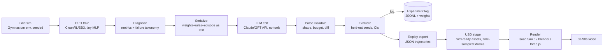

# WeightShift: an LLM edits a warehouse robot's weights directly
*(working title "Loop Doctor". Plan v1, researched 2026-11-04. Audience: the builder agent working in `C:\Projects\QuickWins\LoopDoctor`)*

> Research brief, not a code spec. The builder decides the code. Facts with a source are cited in §15 with the date checked. Anything marked **[UNVERIFIED]** must be confirmed before you rely on it.

## 1. Goal & hypothesis
Reproduce, at hobby scale, the "fix" experiment in MIT CSAIL's *Sparks of Weight-Space Programming* (Takehi, Teoh, Zhang, Khattab, published 2026-11-02) [S1]. In that experiment, GPT-6 Astra was given a PPO policy's raw weights as text, a description of the scene, and one recorded episode. It explained why the policy was stuck in a local minimum, then rewrote the weights. Its edit changed 3.5% of the weights, added a small separate path through a few units per layer, and took success from 0 to 1,024/1,024 episodes. It worked in one try, with no tools.

**Hypothesis:** a frontier LLM can read a tiny PPO policy (about 20k weights) for a warehouse-picking grid game, find the cause of a failure we have measured (for example looping, or ignoring far shelves), and fix it by editing weights directly, with no gradients, no training code, and few or no rollouts. Success means a statistically significant improvement on held-out seeds while the other metrics don't get worse.

## 2. Success criteria
- **Valid positive result:** on ≥1,000 held-out evaluation episodes with fixed seeds the LLM never saw, the targeted failure metric improves and the 95% bootstrap CI of the difference excludes 0. Mean score must not drop by more than 5% relative (non-regression). All edits must be ≤ a stated budget, say 10% of weights changed. Report the actual fraction.
- **Required baselines.** The result only counts if it is compared against all of these:
  - (a) the unedited policy
  - (b) random perturbation of the same weights at the same magnitude
  - (c) a cheap non-LLM fix: a hand edit or an activation-direction ablation
  - (d) continuing PPO for the same wall-clock time, as a reference rather than a competitor
- **Reproducibility:** every prompt and response, the weight file hashes, the seeds, the model ID and date, and the cost go into the experiment log.
- **Negative results are publishable.** "Frontier LLM could not fix X, here's what it tried" is an honest, interesting post. The blog itself reports a failure: Astra could not improve Gemma 3 270M at math [S1]. Never cherry-pick seeds or attempts. Report every attempt.

## 3. Name
- **Chosen: WeightShift.** It works as a warehouse *shift* and as a *shift* in weights. It's short and fits a LinkedIn hook.
- Alternates: **Pallet Surgeon** (clearly says "fix"), **Rackwright** (a wright who builds racks and also writes weights).

## 4. Architecture overview

Keep Python (sim, training, LLM harness, eval, USD export) separate from rendering. The only interfaces between the two are files: `.npz`/`.json` weights, `.jsonl` trajectories, and `.usda` stages.

## 5. Game spec (loosely inspired by Grocery Bot. Their code, art and names are not used)
How Grocery Bot works, for reference [S2]: a grid store, robots carry up to 3 items, robots pick from adjacent shelves that never run out, robots block each other, actions are move/pick/load/wait, +1 per loaded item, +5 per completed order, 300 rounds, and five difficulty levels from 12×10 with 1 robot up to 30×18 with 20 robots.

**WeightShift v0 (single robot, 10×10). Match the blog's input/output style so the method carries over:**
- **Grid:** 10×10. The outer wall plus 2–3 rack rows count as obstacles. Racks hold a SKU type (start with 4 SKUs). One drop-off dock is on an edge. Layouts are generated from a seed, with a fixed "eval layout set" and separate "train layouts".
- **Observation:** a 10×10 grid × 6 channels = 600 inputs.
  1. robot
  2. obstacles/racks
  3. rack cells holding a SKU still needed by the current order (reward targets)
  4. dock
  5. previous robot position (motion/trail, like the blog's "previous frame")
  6. a carried/needed summary, either broadcast as constant planes or encoded in a reserved border region

  Plus ~8 scalars (items carried 0–3, steps remaining fraction, needed counts per SKU). The total input stays around 610.
- **Actions (7):** no-op, up, down, left, right, pick (adjacent needed rack), drop (at the dock).
- **Rewards:** +1 per delivered item, +5 per completed order (same structure as Grocery Bot), plus an optional tiny step cost. Episodes last 200 steps. A wrong pick takes up a slot, as in GB, which makes failure modes more interesting.
- **Network:** MLP 610 → 32 → 32 → 7, tanh. That is ≈20.8k weights, close to the blog's 17,253 for 500→32→32→5 [S1].
- **Scale-up later, only after go/no-go:** 16×12 with 3 robots and a shared policy, adding collisions and deadlocks.

## 6. Training setup
- **PPO:** use either the CleanRL single-file `ppo.py` (easiest to read and hack) or Stable-Baselines3 2.9.2 (released 2026-10-26; needs Python ≥3.10, PyTorch ≥2.8, Gymnasium ≥0.29.1,<2.0) [S6].
- Use a vectorized env with 32–64 envs. A 20k-param MLP trains faster on **CPU** than on GPU, so use the GPU only if the sim is batched in torch.
- The blog used 1B steps [S1]. That much is unnecessary here. Aim for 5–50M steps, which is minutes to roughly an hour.
- Train 3–5 seeds. **We want a policy that is decent but flawed**, so save checkpoints along the way.
- **If PPO is too good:** induce a failure the same way the blog's local-minimum car arose. Options:
  - reward shaping that encourages short trips
  - placing one SKU rack far from the dock on the train layouts
  - training only on layouts where the dock is on one side
- Document how the failure arose. Engineering a failure on purpose is fine as long as you disclose it.

## 7. Failure diagnosis
Metrics, computed per episode, then aggregated:
- items/order completion rate
- **loop index:** revisits of the same (cell, carried-state) within a window of k steps
- **idle fraction:** no-op or bumping into a wall
- **far-shelf neglect:** pick rate as a function of the rack's distance from the dock
- wrong-pick rate
- full-inventory-but-not-delivering
- later, in multi-robot: deadlock count and collisions

Produce a short "failure card" for the LLM. It includes:
- the metric table
- one representative episode as an ASCII trajectory
- action-probability snapshots at 3–5 key states

Optional interpretability aids to compute for **our** analysis and for baseline (c): first-layer weight heatmaps per channel (the blog notes that where those weights concentrate is what revealed which game a network played [S1]), and linear probes / mean activation differences between "looping" and "healthy" states.

## 8. LLM weight-editing protocol
**Decision: no tools in the main condition.** This matches the blog's fix experiment [S1]: a single reply, weights in and weights out as text. It stops the LLM from writing a training loop, running hill-climbing, or simulating rollouts.
- **Secondary condition, clearly labelled:** a Python sandbox (numpy only, no env, no autograd, no optimizer), plus a small **forward-pass budget** such as 0/5/20 batched evaluations of 64 episodes. This mirrors the blog's Go/Qwen harness [S1].
- The harness itself enforces the rules: no torch/autograd, no env import, a hard cap on evaluations, and all sandbox code logged. Any run that breaks a rule is discarded.

**Prompt structure, in order:**
1. role/task
2. env rules: grid, channels, actions, rewards, and the exact input-index layout
3. architecture plus the serialization spec
4. the failure card
5. the full weights
6. the instructions: explain the cause of the failure first, then fix only that cause, keep the edits minimal, and say which units/paths you changed and why
7. output format

**Weight text format:**
- one block per tensor with a header (`L1.W shape=[32,610] row=out-unit`)
- 3–4 significant decimals, one row per line
- input columns grouped by channel and annotated with (channel, row, col) so the spatial structure is easy to read
- **Output format:** a sparse diff (`tensor,i,j,new_value`) or whole replaced tensors. The harness validates shapes, NaNs, magnitude, and the edit budget, and rejects anything else.

**Token math:**
- ≈20.8k numbers at about 4–6 tokens each (`-0.1234 ` plus separators) comes to ~90–130k input tokens, plus ~5k of context.
- Output: a reasoning/explanation plus a sparse diff of 500–2,000 entries, about 10–30k tokens. A full rewrite would be ~100k output tokens, so prefer diffs.
- Measure the real count with each provider's token counter. Claude 4.7+ models use a tokenizer that produces ~30% more tokens for the same text [S4].

**Cost per edit attempt** (about 120k input, 30k output; list prices on 2026-11-03/04) [S4][S5]:

| Model | In/Out $/MTok | ≈ $/attempt |
|---|---|---|
| GPT-6 Astra (the blog's model) | 10 / 50 | ~2.7 |
| Claude Opus 5.5 | 4 / 20 | ~1.1 |
| GPT-6.1 Sol | 2 / 10 | ~0.55 |
| Claude Sonnet 5.5 | 2 / 10 | ~0.55 |
| GPT-6 Luna (cheap control) | 0.10 / 0.50 | ~0.03 |

- GPT short-context pricing applies while the prompt is ≤272K tokens [S5]. Batch APIs cost half [S4][S5].
- Use prompt caching for the shared prefix across repeated attempts.
- Budget: about 10 attempts × 3 models × 2 failures, which is under $100.

**Guardrails:**
- Stay blind to the eval seeds.
- Allow at most N attempts per condition and report every attempt; best-of-N is disclosed as best-of-N.
- Fix the temperature and reasoning-effort settings and log them.
- Save the model ID and date with each result.

## 9. Evaluation protocol
- Train seeds, diagnosis seeds (the LLM may see these episodes), and **held-out eval seeds** are disjoint. Also test on unseen layouts to check generalization.
- Run ≥1,000 episodes per condition with **paired** seeds, so that "before" and "after" run on identical seeds.
- Sample actions (as the blog does [S1]) and also report greedy (argmax) results.
- Metrics: mean score, order completion, and the targeted failure metric. Give **95% bootstrap CIs** and a paired test (Wilcoxon signed-rank or a paired bootstrap). Apply Holm correction when testing several metrics.
- **Edit analysis:** fraction of weights changed, L2 of the change, which units changed, and whether the LLM's stated mechanism holds. Check the mechanism by ablating the edited units and seeing whether the fix disappears.
- **Log:** append-only JSONL plus stored weight files, with one row per attempt: condition, model, tokens, $, rule violations, and metrics.

## 10. 3D replay + video pipeline
**Assets:**
- **`nvidia/simready-assets`** on Hugging Face, part of SimReady Central, announced 2026-10-21. It has about 2,575 asset folders.
  - The repo has no card and no licence tag, **but every package ships `.metadata/LICENSE.txt` and declares CC-BY-4.0** in `com.nvidia.simready.packaging.json` [S3a][S3b].
  - Check each package you download and keep an `ATTRIBUTION.md` (asset, by NVIDIA, source, CC BY 4.0, modified).
- **`nvidia/PhysicalAI-SimReady-Warehouse-01`** (CC-BY-4.0, v1.1.0, 753 USD assets, ~15 GB, intended for Isaac Sim 4.x) is a warehouse-specific set with a CSV catalog [S3c]. Use that CSV to choose racks, pallets, totes/boxes, and dock items.
- **Avoid** the older Omniverse content packs (Warehouse, etc.). Per an NVIDIA forum post, these fall under Isaac Sim asset terms that restrict redistribution [S3a].
- For the robot, find an AMR/forklift asset in either set. Otherwise use a simple box-on-wheels proxy. **[UNVERIFIED: exact asset names for racks/AMRs. Search the CSV.]**

**Stage assembly (Python, `usd-core`):**
- Map each grid cell to 1.2 m. Reference the assets as USD references/payloads.
- Animate each robot with **time-sampled `xformOp:translate`/`rotateZ`** at 1 grid step = N frames, with interpolation between steps. Show carried totes as child prims whose visibility is time-sampled.
- Build the before and after episodes on the **same seed**, in two stages or side by side in one stage with an X offset.

**Renderer options, in order:**
1. **Isaac Sim 6.0.0**, GA June 2026. It is free to download, has a native Windows 11 build (Win10 unsupported), and has validated drivers Win 581.42 / Linux 580.95.05 [S7]. Blackwell is supported. On 5.1, 595.x drivers crashed on 50-series cards and 591.74 worked [S8]. **If launch crashes, install the validated driver.** Use the Movie Capture / path-traced render to EXR/PNG.
2. **Blender** with its USD importer as a fallback. **[UNVERIFIED: how well SimReady MDL materials survive Blender import. Expect to re-assign materials.]**
3. **three.js** as a web fallback, using a converted glTF and the trajectory JSON. This plays to Daniel's strengths and could double as an interactive demo.

**Video (60–90 s, 1080×1350 or 1920×1080):**
1. 0–5 s: hook, "I asked an AI to perform surgery on a robot's brain"
2. 5–15 s: the game in 2D
3. 15–30 s: the trained robot looping (3D)
4. 30–45 s: the weight heatmap, with the LLM's diagnosis quote overlaid and the edited cells highlighted
5. 45–70 s: before/after side by side with live score counters
6. 70–85 s: the stats card (CI, % weights changed, $ per edit)
7. 85–90 s: credit to the MIT CSAIL blog, link

Compose in DaVinci Resolve or ffmpeg. Render score overlays from the trajectory JSON.

## 11. Milestones (about 1.5–2 weeks part-time)
1. **Day 1–2:** env, random and scripted-greedy baselines, ASCII renderer, metrics. Unit-test determinism across seeds.
2. **Day 3:** PPO on 10×10, then pick or induce a flawed checkpoint and write the failure card.
3. **Day 4: GO/NO-GO.** Run one serialization plus 3 attempts each on 2 models, evaluated on 1,000 held-out episodes. **GO** means at least one significant, non-regressing fix, *or* a clearly documented negative result worth writing up. No 3D work until this gate is passed.
4. **Day 5–6:** the full protocol: baselines (b)–(d), the tools condition with forward-pass budgets, and the mechanism ablation.
5. **Day 7–8:** export the USD stage and render in Isaac Sim, or fall back.
6. **Day 9–10:** edit the video, write the post, and publish the repo with the log and attribution.
7. **Stretch:** 3 robots with deadlocks, and asking the LLM to write a policy from scratch (the blog's MinAtar experiment [S1]).

## 12. Hardware notes (RTX 5090, Windows)
- **PyTorch:**
  - Blackwell (sm_120) needs builds against CUDA ≥12.8. Stable releases from 2.7.0 onward support it [S9].
  - From PyTorch 2.12, cu128 wheels are deprecated. **cu130 is the stable PyPI build** and cu132 is experimental [S10].
  - Install with `--index-url https://download.pytorch.org/whl/cu130` and check that `torch.cuda.get_arch_list()` includes `sm_120`.
  - Avoid cu126 wheels and packages that silently downgrade torch [S9][S11].
- The PPO for this net is CPU-bound, so the GPU matters mostly for Isaac Sim rendering. 32 GB of VRAM is well above Isaac Sim's 16 GB minimum [S7].
- Use one venv per tool. Isaac Sim ships its own Python, so don't mix it with the training environment.

## 13. Risks / open questions
- **Context and precision:** 100k+ tokens of numbers may push the LLM toward shallow heuristics. Mitigations: fewer decimals, pre-annotated channel blocks, or a smaller net (e.g. 610→16→16→7).
- **The LLM may "fix" the problem by over-steering** in a way that hurts score elsewhere. That is why non-regression is required.
- **Results may not replicate with non-Astra models.** That is a finding in itself, so report it.
- **PPO might not produce a clean, nameable failure.** Inducing one is acceptable but must be disclosed.
- **Licensing ambiguity:** the HF repo has no root licence for simready-assets [S3b]. Rely on the per-package files and keep attribution.
- **Isaac Sim stability** on recent Game Ready drivers [S8]. Keep the Blender/three.js route open.
- **Open:** should the LLM see the episode trajectory? The blog gave one [S1]. Run an ablation with and without it if the budget allows.

## 14. NM i AI fair-play note
This is a **separate environment** inspired only loosely by Grocery Bot. Don't reuse Grocery Bot code, protocol, assets, maps, or branding, and don't connect to their servers.
**Don't publish strategies, heuristics, or trained policies tuned to the competition**, or anything that maps directly onto the Grocery Bot stores. GB's own fair-play rules allow any method in competition play [S2]. Our concern is not leaking competition advantage publicly while NM i AI is ongoing. Give credit along the lines of "inspired by" only, and avoid their name in the title.

## 15. Sources (accessed 2026-11-04 unless noted)
- [S1] Takehi et al., "Sparks of Weight-Space Programming", MIT CSAIL, 2026-11-02. https://rikiyat.github.io/blog/weight-space-programming/ · logs: https://github.com/RikiyaT/lm_understand-logs
- [S2] Grocery Bot, How to play. https://grocerybot.no/how-to-play
- [S3a] NVIDIA Dev Forum, licence of nvidia/simready-assets. https://forums.developer.nvidia.com/t/licence-of-nvidia-simready-assets-hugging-face-for-redistribution-in-customer-scenes/387081
- [S3b] NewsNix, "NVIDIA Put 2,575 OpenUSD Assets Under CC BY 4.0…", 2026-10-26. https://newsnix.com/articles/nvidia-simready-2575-assets-cc-by-licence-invisible/ · dataset: https://huggingface.co/datasets/nvidia/simready-assets
- [S3c] https://huggingface.co/datasets/nvidia/PhysicalAI-SimReady-Warehouse-01 (README v1.1.0, 2025-05-18)
- [S4] Anthropic pricing. https://docs.anthropic.com/en/docs/about-claude/pricing
- [S5] OpenAI pricing. https://developers.openai.com/api/docs/pricing (cross-check: https://measuredlab.com/api-pricing/, 2026-11-03)
- [S6] stable-baselines3 2.9.2 on PyPI (2026-10-26). https://pypi.org/project/stable-baselines3/ · CleanRL: https://github.com/vwxyzjn/cleanrl
- [S7] Isaac Sim 6.0.0 download and requirements. https://docs.isaacsim.omniverse.nvidia.com/6.0.0/installation/download.html · https://docs.isaacsim.omniverse.nvidia.com/6.0.0/installation/requirements.html · GA post 2026-06-08: https://forums.developer.nvidia.com/t/isaac-sim-6-0-general-availability/372621
- [S8] Driver crash reports (Isaac Sim 5.1, 595.x). https://github.com/isaac-sim/IsaacLab/issues/4961 · https://forums.developer.nvidia.com/t/isaac-sim-error-on-rtx-5060-gb-laptop-gpu/371956
- [S9] PyTorch forums, sm_120 support. https://discuss.pytorch.org/t/pytorch-support-for-sm-120/222119
- [S10] PyTorch 2.12 CUDA matrix. https://dev-discuss.pytorch.org/t/introducing-cuda-13-2-and-deprecating-cuda-12-8-release-2-12/3337/1
- [S11] RTX 5090 survival guide (community). https://dev.to/madcoolseed/rtx-5090-survival-guide-sm120-cuda-12-and-13-side-by-side-and-the-xformers-trap-25nh

**[UNVERIFIED] items:** exact SimReady asset names for racks, pallets, totes and AMRs; whether Isaac Sim 6.0 runs cleanly on the newest 2026 Game Ready drivers on a 5090; Blender's handling of SimReady MDL materials; CleanRL's current version and maintenance status; real token counts per tokenizer (estimated above); whether Isaac Sim 6.0.x has a newer patch (6.0.1 docs exist).
